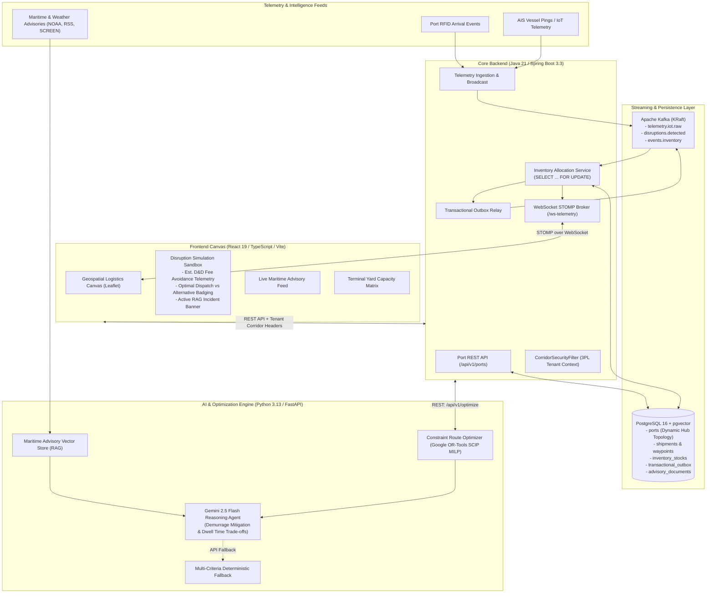

# SupplyChain Copilot

### Enterprise Event-Driven Logistics Disruption & Route Optimization Platform

A resilient, multi-tiered enterprise supply chain copilot that tracks real-time global shipment telemetries, correlates maritime and geopolitical disruptions using continuous vector RAG, optimizes contingency re-routings via Google OR-Tools MILP solvers, leverages Google Gemini 2.5 Flash for operational trade-off briefs, and commits warehouse inventory allocations with ACID consistency.

---

## 1. System Architecture



---

## 2. Directory Structure

```
supplychain-copilot/
├── apps/
│   └── web-client/                     # React 19 + TypeScript + Vite + Tailwind CSS
│       ├── src/
│       │   ├── components/             # GeospatialMap, SimulationSandbox, DisruptionFeed, InventoryRiskMatrix
│       │   ├── services/api.ts         # REST client, port fetching & STOMP WebSocket helpers
│       │   └── types/index.ts          # Strongly typed domain interfaces (Port, Shipment, Advisory, etc.)
│       ├── package.json
│       └── vite.config.ts
├── services/
│   ├── core-backend/                   # Java 21 / Spring Boot 3.3 Core Backend
│   │   ├── src/main/java/com/supplychain/copilot/
│   │   │   ├── config/                 # SecurityConfig, WebSocketConfig, DataSeeder
│   │   │   ├── domain/model/           # Port, Tenant, Corridor, Shipment, Warehouse, InventoryStock, Outbox
│   │   │   ├── repository/             # PortRepository, InventoryStockRepository (PESSIMISTIC_WRITE)
│   │   │   ├── service/                # PortService, SimulationService, InventoryAllocationService
│   │   │   ├── websocket/              # TelemetryWebSocketController & MockTelemetryGenerator
│   │   │   └── controller/             # PortController, ShipmentController, SimulationController, etc.
│   │   ├── src/main/resources/
│   │   │   ├── db/migration/           # Flyway migrations (V1__init_schema.sql, V2__add_ports_table.sql)
│   │   │   └── application.yml
│   │   ├── src/test/java/              # Concurrency, Validation & Allocation Integration Tests
│   │   ├── pom.xml
│   │   └── mvnw.cmd
│   └── ai-engine/                      # Python 3.13 / FastAPI Optimization & RAG
│       ├── app/
│       │   ├── solver/                 # Google OR-Tools SCIP MILP Solver with dynamic candidate hubs
│       │   ├── rag/                    # Advisory vector store & cosine similarity search
│       │   ├── agent/                  # Trade-off agent: Gemini 2.5 Flash + Deterministic fallback
│       │   └── main.py                 # FastAPI application
│       ├── tests/                      # Python unit tests (test_optimizer.py, test_tradeoff_agent.py)
│       └── requirements.txt
├── infrastructure/
│   └── docker/
│       ├── docker-compose.yml          # PostgreSQL 16 (pgvector), Kafka (KRaft), Redis 7
│       └── init-db.sql                 # Database extension initializations
└── README.md
```

---

## 3. Environment Variables Reference

| Variable | Service | Default Value | Description |
| :--- | :--- | :--- | :--- |
| `SPRING_PROFILES_ACTIVE` | Core Backend | `dev` | Profile selector (`dev` uses in-memory H2 with PostgreSQL syntax; `prod` uses PostgreSQL). |
| `SPRING_DATASOURCE_URL` | Core Backend | `jdbc:postgresql://localhost:5432/supplychain_db` | PostgreSQL connection URL (when running in `prod` profile). |
| `SPRING_DATASOURCE_USERNAME` | Core Backend | `postgres` | Database user. |
| `SPRING_DATASOURCE_PASSWORD` | Core Backend | `postgres` | Database password. |
| `AI_ENGINE_URL` | Core Backend | `http://localhost:8000` | Host URL for the Python AI Engine solver service. |
| `GEMINI_API_KEY` | AI Engine | _(Optional)_ | Google Gemini API key. When present, enables real-time Gemini 2.5 Flash executive trade-off summaries. When omitted, gracefully uses deterministic multi-criteria fallback. |
| `GOOGLE_API_KEY` | AI Engine | _(Optional)_ | Alternate key alias for Google GenAI SDK. |

---

## 4. Quick Start in 3 Commands

### Step 1: Start Infrastructure (Optional for Production)

If running with full Docker infrastructure:

```bash
cd infrastructure/docker
docker compose up -d
```

*(Note: When developing locally without Docker, `services/core-backend` automatically defaults to its built-in `dev` profile with in-memory persistence and automated mock telemetry streaming!)*

---

### Step 2: Start the Java 21 Core Backend

```bash
cd services/core-backend
$env:JAVA_HOME = "C:\Program Files\Eclipse Adoptium\jdk-21.0.4.7-hotspot"  # (Windows PowerShell)
.\mvnw.cmd spring-boot:run
```

- **REST API**: `http://localhost:8081/api/v1` (or `8080` in Docker)
- **Ports API**: `http://localhost:8081/api/v1/ports`
- **WebSocket STOMP Broker**: `http://localhost:8081/ws-telemetry`
- **H2 / DB Console**: `http://localhost:8081/h2-console`

---

### Step 3: Start the Python AI & Optimization Engine

```bash
cd services/ai-engine
.\.venv\Scripts\python.exe -m uvicorn app.main:app --port 8000 --reload
```

- **Interactive OpenAPI Docs**: `http://localhost:8000/docs`
- **Health Check**: `http://localhost:8000/health`

---

### Step 4: Start the React 19 Frontend

```bash
cd apps/web-client
npm run dev
```

Open **`http://localhost:5173`** in your browser.

---

## 5. Key Endpoints & API Reference

| Service | Method | Route | Description |
| :--- | :--- | :--- | :--- |
| **Core Backend** | `GET` | `/api/v1/ports` | Retrieves all active maritime hubs (coordinates, draft depth, delay hours, cost per TEU). |
| **Core Backend** | `GET` | `/api/v1/ports/{code}` | Retrieves details for a specific port by UN/LOCODE (e.g. `NLRTM`, `BEANR`). |
| **Core Backend** | `GET` | `/api/v1/shipments` | Lists active shipments with 3PL corridor tenant filtering. |
| **Core Backend** | `POST` | `/api/v1/shipments/{id}/telemetry` | Ingests new GPS / AIS coordinates. |
| **Core Backend** | `POST` | `/api/v1/simulations/run` | Triggers constraint-based route optimization with dynamic candidate ports. |
| **Core Backend** | `POST` | `/api/v1/simulations/commit` | Atomically commits inventory reallocations under pessimistic write lock (`SELECT FOR UPDATE`). |
| **Core Backend** | `GET` | `/api/v1/inventory` | Retrieves terminal yard stock and occupancy. |
| **Core Backend** | `GET` | `/api/v1/disruptions` | Retrieves top 10 maritime / weather advisories. |
| **AI Engine** | `POST` | `/api/v1/optimize` | Google OR-Tools SCIP MILP solver + Gemini 2.5 Flash / RAG trade-off explainer. |
| **AI Engine** | `GET` | `/api/v1/rag/search?q={query}` | Vector similarity search across indexed maritime advisories. |
| **AI Engine** | `POST` | `/api/v1/rag/index` | Embeds and stores an advisory into the vector store. |

---

## 6. Verification & Automated Test Suites

All test suites across every tier can be executed independently:

```bash
# 1. Java Core Backend (Integration & ACID Concurrency Tests)
cd services/core-backend
$env:JAVA_HOME = "C:\Program Files\Eclipse Adoptium\jdk-21.0.4.7-hotspot"
.\mvnw.cmd test

# 2. Python AI Engine (OR-Tools, RAG Vector Store, Gemini Agent Fallback)
cd services/ai-engine
.\.venv\Scripts\python.exe -m unittest discover tests

# 3. React 19 Frontend (Linter & Production Bundle)
cd apps/web-client
npm run lint
npm run build
```

---

## 7. ACID Transactional Guarantees & 3PL Tenant Security

1. **Pessimistic Locking (`PESSIMISTIC_WRITE`)**:
   During inventory reallocation, `InventoryStockRepository.findForUpdateByWarehouseIdAndSku()` issues a `SELECT ... FOR UPDATE` lock in PostgreSQL. Concurrent requests for stock at the same terminal wait, ensuring zero race conditions and no negative inventory.
2. **Transactional Outbox Pattern**:
   When reallocating stock or rerouting vessels, domain events (`InventoryAllocatedEvent`) are written to the `transactional_outbox` table in the *same local database transaction*, eliminating dual-write inconsistencies.
3. **Multi-Tenant Corridor Isolation**:
   Requests carry `X-Tenant-Id` and `X-Authorized-Corridors` headers. `CorridorSecurityFilter` binds authorization to `TenantContext`. Queries automatically enforce corridor boundaries, preventing 3PL partners from accessing unassigned shipping corridors.

---

## 8. Operational Troubleshooting Playbook

| Issue | Root Cause | Remediation |
| :--- | :--- | :--- |
| **Gemini LLM Quota / 403 / No API Key** | `GEMINI_API_KEY` is not set or quota has been reached. | The AI Engine will log a warning and automatically degrade to the built-in deterministic synthesizer without throwing 500s. To enable live LLM generation, set `export GEMINI_API_KEY="your-key"`. |
| **WebSocket Disconnected in Web UI** | Backend server restarted or not reachable on `8080`. | The React frontend features silent auto-reconnect via STOMP `reconnectDelay: 10000`. If backend is down, the UI seamlessly falls back to synthetic dead-reckoning vessel interpolation. |
| **Flyway Checksum Mismatch** | Migration file was edited after initial Flyway execution. | In local development, execute `docker compose down -v` to reset PostgreSQL volume or restart with the in-memory `dev` profile. |
| **Leaflet Map Container Re-initialization** | React StrictMode double-mounting map container. | `GeospatialMap.tsx` implements strict container cleanup: deleting `_leaflet_id` and calling `map.remove()` on unmount. |
| **Port Not Appearing on Map Canvas** | Port record marked as `active = false` in the database. | Check the `ports` table: `UPDATE ports SET active = true WHERE code = '...';` or inspect `GET /api/v1/ports`. |
